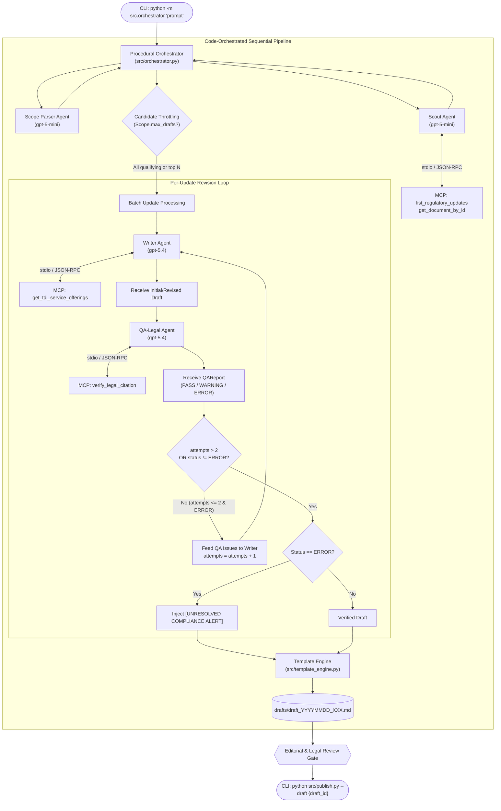

# HSE Easy — Approach 1 Architecture Document
## Content Factory (Code-Orchestrated Pipeline)

---

### 1. Executive Summary & Core Architectural Principle

**HSE Easy** is an industrial, deterministic editorial assembly line that transforms Italian and European Union Health-Safety-Environment (HSE) regulatory notices into compliant, publication-ready technical content with embedded commercial Call-to-Action (CTA) hooks for TDI (Tecno Dati Industriali).

#### Core Principle: "Code Owns the Flow"
* **Zero Autonomous Pipeline Sequencing:** Autonomous agent branching, open-ended loops, and self-directed agent-to-agent delegation are strictly forbidden.
* **Procedural Python Orchestration:** All routing, state transitions, candidate filtering, iteration limits, error recovery, and persistence are hardcoded in imperative Python using the **Strands Agents SDK** (`strands-agents`).
* **Callable Workers:** LLM-backed agents behave strictly as stateless or task-bounded functional workers that execute one specific task per invocation and return structured outputs.
* **Explicit Human Gate:** The pipeline persists candidate drafts to disk (`drafts/`); direct automated publishing to production systems without human review is an explicit non-goal. Final publication requires human inspection and manual trigger of `publish.py`.

---

### 2. High-Level System Architecture



---

### 3. Component Breakdown & Strands Agent Roles

> [!NOTE]
> **The "Scoped Tools" column below is superseded by D19** for Scout, Writer and QA-Legal: all three receive every substrate tool. The entries are retained as *declared intent* — what each worker is expected to reach for — and as the scoping argument used in the Phase 8 comparison. ScopeParser remains genuinely tool-free. Role boundaries are enforced by system-prompt non-goals and audited via `AgentTelemetry.tool_invocations`.

| Component | Technology / Model | Role & Responsibilities | Scoped Tools |
| :--- | :--- | :--- | :--- |
| **Scope Parser** | Strands `Agent`<br/>`gpt-5-mini` | One-shot natural language extraction of time window, regulatory sources, sector constraints, and optional draft ceiling from raw user prompt. | None (pure extraction) |
| **Scout Agent** | Strands `Agent`<br/>`gpt-5-mini` | Queries local regulatory intelligence, scores editorial relevance/novelty, and filters out non-impactful notices. | `list_regulatory_updates`<br/>`search_regulatory_docs`<br/>`get_document_by_id` |
| **Writer Agent** | Strands `Agent`<br/>`gpt-5.4` | Generates a publication-ready HSE technical article adhering to TDI editorial guidelines and injects pre-approved commercial CTAs. In revisions, ingests explicit QA feedback. | `get_tdi_service_offerings`<br/>`get_document_by_id` |
| **QA-Legal Agent** | Strands `Agent`<br/>`gpt-5.4` | Audits every citation and statutory statement against certified national/EU legal registries. Emits structured `QAReport`. | `verify_legal_citation` |
| **Procedural Orchestrator** | Pure Python<br/>(`src/orchestrator.py`) | Drives execution sequencing, evaluates termination conditions, manages stdio MCP connections, calculates telemetry, and formats output. | File I/O, Subprocess management, Strands Telemetry |
| **Template Engine** | Pure Python<br/>(`src/template_engine.py`) | Merges article sections, QA badges, verified citations, and runtime benchmarks into `.agents/templates/draft.md`. | Regex/String templating |

---

### 4. MCP Substrate Integration (`hse-easy-mock`)

Communication with the local mock MCP server is conducted strictly over `stdio` using JSON-RPC 2.0.

#### Subprocess Launch Configuration
```bash
uv run --directory C:\Users\Saksham\Git\poc\AIAgents\mcp-server fastmcp run server.py
```

#### Advertised Tools & Schemas
The MCP server exposes full JSON Schemas via `outputSchema` during `tools/list`:
1. `list_regulatory_updates`: Lists recent HSE decrees, directives, and circulars. Returns `List[RegulatoryUpdateSummary]`.
2. `search_regulatory_docs`: Bilingual keyword/topic search over the regulatory database. Returns `List[RegulatoryUpdateSummary]`.
3. `get_document_by_id`: Retrieves full text, obligations, and penalties for a specific slug. Returns `RegulatoryDocument`.
4. `verify_legal_citation`: Verifies legal soundess, current in-force validity, and canonical URLs. Returns `CitationVerificationResult`.
5. `get_tdi_service_offerings`: Retrieves matching commercial consulting services and pre-approved CTAs. Returns `List[TDIServiceOffering]`.

---

### 5. Step-by-Step Data Flow & Control Logic

1. **Invocation:** User runs `python -m src.orchestrator "Analyze recent INAIL updates on heat stress"`.
2. **Scope Parsing:** `ScopeParser` extracts `PipelineScope` (`sources=['INAIL']`, `time_window='past_3_months'`, `max_drafts=None`).
3. **Scout Triage:** 
   * `ScoutAgent` calls `list_regulatory_updates` and ranks updates by `impact_level` and HSE relevance.
   * If `scope.max_drafts` is set, truncates candidates to $N$. If unset, retains **all** qualifying updates meeting threshold.
4. **Drafting & Legal Audit Loop:** For each qualifying update:
   * **Initialization:** `attempts = 1`.
   * **Drafting:** `WriterAgent` fetches full document and TDI service offering, outputting `ArticleDraft` (Headline, Summary, Body, TDI CTA).
   * **QA Audit:** `QALegalAgent` extracts legal citations from draft, queries `verify_legal_citation` for each, and produces `QAReport`.
   * **Termination Condition:**
     * If `QAReport.status` is `PASS` or `WARNING`: Loop terminates immediately and proceeds to compilation.
     * If `QAReport.status` is `ERROR`:
       * If `attempts <= 2`: `attempts += 1`. The orchestrator constructs a typed `RevisionPayload` containing `current_draft.model_dump()` and `qa_report.model_dump()`, invoking the `WriterAgent` with the structured payload, and re-auditing with `QALegalAgent`.
       * If `attempts > 2`: Revision terminates without re-calling the Writer; an `[UNRESOLVED COMPLIANCE ALERT]` notice is appended to review notes.
5. **Artifact Compilation:** Draft metadata and telemetry are assembled into `drafts/draft_{YYYYMMDD}_{XXX}.md`.
6. **Publication Gate:** Editorial staff reviews draft on disk; runs `python src/publish.py --draft {draft_id}` to finalize publication.

---

### 6. Observability, Telemetry & Cost Accounting

The system utilizes built-in telemetry from the Strands Agents SDK:

#### 1. Metric Collection via `AgentResult.metrics`
After each agent execution, the orchestrator queries `result.metrics.get_summary()`:
* **Token Usage:** `accumulated_usage.inputTokens`, `accumulated_usage.outputTokens`, `accumulated_usage.totalTokens`.
* **Execution Duration:** `accumulated_metrics.latencyMs` and `total_duration`.
* **Tool Statistics:** `tool_usage.<tool_name>.execution_stats` (call counts, runtimes, success rates).

#### 2. Cost Calculation Formula
Cumulative cost per draft is computed deterministically across all stages and revision attempts:
$$\text{Cost} = \sum_{\text{stages}} \left( \frac{\text{Input Tokens}}{10^6} \times \text{Rate}_{\text{input}} + \frac{\text{Output Tokens}}{10^6} \times \text{Rate}_{\text{output}} \right)$$
Standard rates are configured per model (`gpt-5-mini` vs `gpt-5.4`).

#### 3. Structured Logging
The root `strands` logger is configured to stream debug/info output to `logs/pipeline_{YYYYMMDD}.log`, ensuring `stdout` remains clean for CLI status outputs.

---

### 7. Guardrails, Edge Cases & Failure Modes

| Edge Case / Failure Mode | Orchestrator Handling Behavior |
| :--- | :--- |
| **Zero Qualifying Updates** | Logs information notice (`"No qualifying updates found"`), cleanly exits without invoking Writer or QA models. |
| **MCP Server Disconnect / Crash** | Catches `MCPError`, terminates execution immediately with actionable diagnostics, preventing orphaned agent runs. |
| **Persistent QA Errors (`attempts > 2`)** | Terminates revision loop to prevent runaway token costs; saves draft flagged with an explicit compliance warning. |
| **Partial Batch Failure** | If one update fails during generation, the orchestrator logs the error and continues processing remaining updates. |
| **Draft ID Collisions** | Automatically inspects `drafts/` and allocates the next sequential integer for the current date (`draft_YYYYMMDD_001`, `002`, etc.). |

---

### 8. Testing & Verification Architecture

* **Unit Tests (`tests/test_unit/`):** Test `ScopeParser` extraction, template engine placeholder replacement, and schema validation.
* **Integration Tests (`tests/test_integration/`):** Test real stdio communication with `hse-easy-mock` and simulate the 3 revision outcomes (`PASS` on attempt 1; `PASS` on attempt 2; failure capped after attempt 2).
* **Deterministic Fixture Harness:** Fast, zero-LLM-cost automated CI testing using mocked agent responses and real MCP fixtures.

---

### 9. Complete Decision Log

| # | Topic | Decision | Alternatives Considered | Rationale |
| :---: | :--- | :--- | :--- | :--- |
| **D1** | Scope & Framework | Approach 1 with Strands Agents SDK | Comparison benchmark; LangGraph; raw LLM APIs | Focuses purely on deterministic procedural pipeline leveraging Strands SDK primitives. |
| **D2** | Execution Interface | CLI-first runner & `publish.py` | Cron daemon; REST API service | Direct human developer/editor workflow with mandatory approval gate. |
| **D3** | Candidate Throttling | Unconstrained by default | Fixed top-1; Hardcoded top-3 | Scout passes all qualifying updates unless the user explicitly bounds `max_drafts`. |
| **D4** | Draft Artifact Format | Markdown only (`draft_<id>.md`) | Dual (JSON + MD); JSON only | Self-contained markdown with embedded metadata fulfills editorial and audit review needs cleanly. |
| **D5** | Non-Functional Target | Development/POC Mode | Strict budget caps; Deep 180s verification | Prioritizes observability, verbose logging, and reproducible mock fixtures. |
| **D6** | Architecture Pattern | Approach A: Procedural Controller | Approach B (Strands Task-DAG); Approach C (Event-Driven) | Maximum simplicity, direct imperative debugging, zero framework overhead, strict adherence to "Code owns the flow." |
| **D7** | Documentation Location | `.agents/docs/` and root `AGENTS.md` | Root-level docs; External wiki | Keeps `.agents/` canonical for agent artifacts while providing root `AGENTS.md` for AI assistant navigation. |
| **D8** | Agent Structured Outputs | Pydantic schema enforcement | Raw unconstrained text; RegEx parsing | Guarantees deterministic, type-safe data transfer across pipeline stages. |
| **D9** | Revision Loop Mechanics | Bounded feedback loop | Infinite loop until PASS; Human-in-the-loop mid-loop | Prevents runaway API costs while allowing targeted self-correction for citation inaccuracies. |
| **D10** | Revision Termination | Terminates when `attempts > 2` | `attempts >= 2` | Explicitly permits up to 2 attempts (initial draft + 1 revision). Terminates once attempt count exceeds 2. |
| **D11** | Flow Representation | Top-to-bottom flowchart (`flowchart TD`) | Sequence diagram | High-contrast visual readability across all displays. |
| **D12** | Draft ID Convention | Date-prefixed sequential ID (`draft_YYYYMMDD_XXX`) | Random UUID; Source slug only | Chronological sorting on disk, human-readable browsing, and deterministic cross-referencing. |
| **D13** | MCP Substrate & Tool Registry | Align with `hse-easy-mock` MCP server | Custom synthetic mock schemas | Uses authoritative server in `mcp-server/` exposing real Pydantic v2 schemas and tools over stdio. |
| **D14** | Draft Metadata Contract | Include `DraftMetadata` mapping 1:1 to `draft.md` | Implicit dictionary passing | Ensures typed validation for all placeholders required by `templates/draft.md`. |
| **D15** | MCP Server Registration | Configured `hse-easy-mock` across workspace configs | Ad-hoc subprocess launch | Standardizes configuration across `.mcp.json`, `.agents/mcp_config.json`, `.vscode/mcp.json`, and plugin directories. |
| **D16** | Verification Harness | Fixture-based integration + unit tests | Live LLM calls on every test run | Fast, deterministic CI runs without consuming live LLM tokens, verifying stdio protocol cleanliness. |
| **D17** | Observability & Telemetry | Native Strands `AgentResult.metrics` & root logger | Custom manual token estimation / external proxy | Strands natively exposes `inputTokens`, `outputTokens`, `totalTokens`, `latencyMs`, and tool statistics. |
| **D18** | Revision Interface Contract | Structured Object Passing (`current_draft.model_dump()` & `qa_report.model_dump()`) | Narrative prompt interpolation; File pointer with `read_file` tool | Delivers typed Pydantic objects directly into the context payload without narrative ambiguity or extra tool-hop latency. |
| **D19** | Worker Tool Access | **Unrestricted substrate access** for Scout, Writer and QA-Legal (all 5 tools); ScopeParser remains tool-free | Per-agent scoped tool bindings (the original §3 "Scoped Tools" column) | Scoping proved to be *under*-provisioning, not discipline: QA-Legal is charged with auditing "every citation **and statutory statement**" (§3), which requires `get_document_by_id` to compare draft claims against `key_obligations` and `penalties_summary` — impossible with `verify_legal_citation` alone. Likewise a Writer that can verify its own citations produces a cleaner first draft and a cheaper run; the bounded revision loop (D9/D10) is a safety net, not a metric to maximise, and it stays verified by the mocked Scenario A/B/C tests (D16) regardless of how often it fires in production. **Consequence:** the role boundary moves from the tool list into the system prompts, which must state each worker's explicit non-goals, and `AgentTelemetry.tool_invocations` becomes the mechanism for detecting role bleed after the fact. The `*_TOOL_NAMES` constants in `src/agents.py` remain as *declared intent* and as the argument that restores scoping for the Phase 8 scoped-vs-unscoped comparison. Supersedes the "Scoped Tools" column of §3 for those three workers. |

