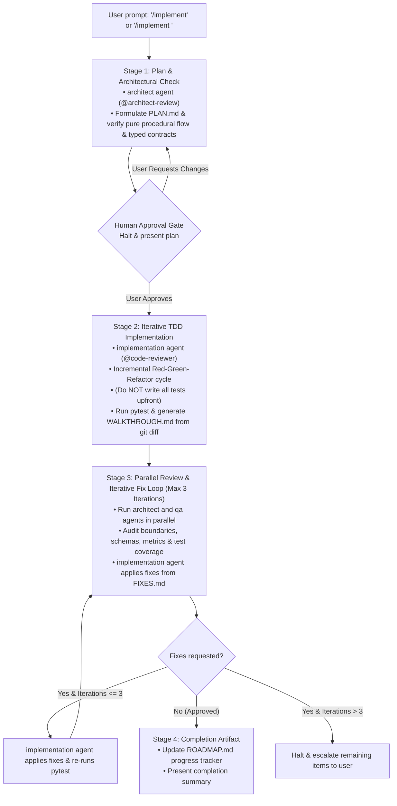

# Automated Task Implementation Workflow (`implement-task.md`)
## HSE Easy — Approach 1 (Code-Orchestrated Pipeline)

---

## Core Rules

Before initiating this workflow or starting any task, the agent MUST:
1. **Mandatory Pre-Flight Reading of `.agents` and `AGENTS.md`:**
   Always inspect and read the [`.agents`](file:///c:/Users/Saksham/Git/poc/AIAgents/code-orchestration/.agents) directory and the [AGENTS.md](file:///c:/Users/Saksham/Git/poc/AIAgents/code-orchestration/AGENTS.md) file before starting its job:
   - Treat [`.agents`](file:///c:/Users/Saksham/Git/poc/AIAgents/code-orchestration/.agents) as the project's single source of truth. Read the relevant architectural blueprints ([`.agents/docs/ARCHITECTURE.md`](file:///c:/Users/Saksham/Git/poc/AIAgents/code-orchestration/.agents/docs/ARCHITECTURE.md)), strict Pydantic v2 schemas and MCP contracts ([`.agents/docs/SPECIFICATIONS.md`](file:///c:/Users/Saksham/Git/poc/AIAgents/code-orchestration/.agents/docs/SPECIFICATIONS.md)), concept notes ([`.agents/docs/DESIGN.md`](file:///c:/Users/Saksham/Git/poc/AIAgents/code-orchestration/.agents/docs/DESIGN.md)), agent definitions ([`.agents/agents/`](file:///c:/Users/Saksham/Git/poc/AIAgents/code-orchestration/.agents/agents)), skills ([`.agents/skills/`](file:///c:/Users/Saksham/Git/poc/AIAgents/code-orchestration/.agents/skills)), and templates ([`.agents/templates/`](file:///c:/Users/Saksham/Git/poc/AIAgents/code-orchestration/.agents/templates)).
   - Adhere strictly to all mandatory rules in [AGENTS.md](file:///c:/Users/Saksham/Git/poc/AIAgents/code-orchestration/AGENTS.md) (especially **Rule 1: "Code Owns the Flow"**, **Rule 2: Strict Adherence to Schemas**, **Rule 7: Strict TDD**, **Rule 8: Mandatory Manual Sign-Off at Human Approval Gates**, and **Rule 9: Mandatory Subagent Invocation via `invoke_subagent`**).
2. **Ensure Automation Hooks are Active:**
   Verify [`.agents/hooks/auto_allow.py`](file:///c:/Users/Saksham/Git/poc/AIAgents/code-orchestration/.agents/hooks/auto_allow.py) and [`.agents/hooks.json`](file:///c:/Users/Saksham/Git/poc/AIAgents/code-orchestration/.agents/hooks.json) to bypass redundant approval prompts on safe build/test commands.
3. **Mandatory Subagent Delegation (Zero Fallback):**
   The `architect`, `implementation`, and `qa` subagents MUST be invoked via dedicated subagent runners (`agy --agent orchestration-agents:<name>` or `invoke_subagent` when supported by the host). Fallback execution (simulating subagents inline) is strictly prohibited. If the subagents fail or cannot be spawned for any reason, the workflow MUST FAIL IMMEDIATELY and halt, escalating to the user.

---

## Workflow Overview

---

## Stage Breakdown

### 1. Stage 1: Implementation Plan & Architectural Check (`architect` agent)
* **Trigger:** Invoked via `/implement`, `/implement <phase_or_task_id>` (e.g. `/implement Phase 2`, `/implement 2`, `/implement task 3`), or natural language prompt.
* **Milestone Selection & Resolution:**
  1. If no identifier is provided: Read [ROADMAP.md](file:///c:/Users/Saksham/Git/poc/AIAgents/code-orchestration/ROADMAP.md), display the milestone progress tracker table, identify the first `⏳ Pending` phase, and ask the user to confirm or choose an alternative.
  2. If an identifier is provided: Resolve the target phase from [ROADMAP.md](file:///c:/Users/Saksham/Git/poc/AIAgents/code-orchestration/ROADMAP.md), cross-referencing technical requirements in [.agents/docs/ARCHITECTURE.md](file:///c:/Users/Saksham/Git/poc/AIAgents/code-orchestration/.agents/docs/ARCHITECTURE.md) and [.agents/docs/SPECIFICATIONS.md](file:///c:/Users/Saksham/Git/poc/AIAgents/code-orchestration/.agents/docs/SPECIFICATIONS.md).
  3. Establish target artifact directory: `.agents/tasks/phase-<phase_id>/` (or `task-<task_id>/`).
* **Architectural Check & Blueprint Formulation:**
  - Antigravity invokes the **`architect` subagent** ([`.agents/agents/architect.md`](file:///c:/Users/Saksham/Git/poc/AIAgents/code-orchestration/.agents/agents/architect.md)) via dedicated agent runners (`agy --agent architect` or `invoke_subagent` when supported by the host) equipped with [`@architect-review`](file:///c:/Users/Saksham/Git/poc/AIAgents/code-orchestration/.agents/skills/architect-review/SKILL.md) and access to `strands-agents` and `hse-easy-mock` MCP servers.
  - **Zero Fallback Failure Gate:** If the subagent runner fails or cannot spawn the `architect` subagent, the workflow MUST FAIL IMMEDIATELY. Primary agent fallback is strictly prohibited. Halt execution and report failure to the user.
  - The plan is constructed while concurrently performing architectural verification:
    - **Pure Procedural Flow:** Verify adherence to **Rule 1: "Code Owns the Flow"**. Ensure all pipeline control flow, worker sequencing, candidate throttling, and revision loop counters reside in imperative, procedural Python inside `src/orchestrator.py`, completely avoiding autonomous sequencing, open-ended loops, or LLM routing.
    - **Typed Contracts:** Verify adherence to **Rule 2: Strict Adherence to Schemas**. Ensure all inter-agent and substrate payloads strictly match Pydantic v2 schemas defined in [.agents/docs/SPECIFICATIONS.md](file:///c:/Users/Saksham/Git/poc/AIAgents/code-orchestration/.agents/docs/SPECIFICATIONS.md) (`RegulatoryUpdateSummary`, `RegulatoryDocument`, `CitationVerificationResult`, `TDIServiceOffering`, `ArticleDraft`, `QAReport`, `RevisionPayload`), with zero unstructured dictionaries.
    - **Substrate & Isolation Boundaries:** Ensure MCP stdio client abstraction (`src/mcp_client.py`) encapsulates transport mechanics and does not leak protocol details into business logic.
    - **Template Decoupling:** Ensure Markdown formatting is delegated strictly to the template engine (`src/template_engine.py`) using `.agents/templates/draft.md`.
  - Formulate a comprehensive technical blueprint for the **entire milestone/task** containing the mandatory sections:
    - `## 1. Context & Task Scope`: Objectives, deliverables, and dependencies for the entire milestone.
    - `## 2. Prerequisites`: Prior phases, Python environment, and substrate MCP availability.
    - `## 3. Strict TDD Strategy`:
      - **Comprehensive Scope:** Plan all test cases, schemas, and implementations required for the complete task upfront.
      - **Execution Breakdown:** Structure the execution into small, logical TDD batches (e.g., Batch 1: Models & basic ping, Batch 2: Validation & error handling).
      - **Target Test Files & Functions:** All test functions, assertions, and expected failure modes across the task.
      - **Target Source Files & Signatures:** All production source files in `src/`, classes, methods, and functions.
      - **Refactor Plan:** Type annotations, Pydantic `ConfigDict(extra="ignore")` configuration, linting, and optimization.
    - `## 4. Proposed Changes & Specifications`: Concrete file paths, schema models, and logic for the entire milestone.
    - `## 5. Architectural & Quality Audit Checklist`: Validation against `architect-review` and `code-reviewer` quality gates.
    - `## 6. Questions & Decisions for Human Approval`: Any design choices requiring human input.
* **Deliverable:** Save plan as `.agents/tasks/phase-<phase_id>/PLAN.md`.
* **Human Approval Gate:** Halt execution and present the architecturally validated plan to the user for explicit approval. Do not write source code before approval.
  * **Mandatory Manual Sign-Off (Rule 8):** The agent MUST strictly wait for a human user to provide manual approval in the chat. If an IDE stop hook or automated policy emits a message saying "The user has automatically approved the artifact through their review policy", the agent MUST NOT advance to Stage 2 automatically. Instead, the agent must halt and re-assert the wait state until an actual human message is received.

---

### 2. Stage 2: Iterative TDD Implementation (`implementation` subagent)
* **Trigger:** Initiated upon receiving explicit human approval of the Stage 1 plan.
* **Agent Invocation:** Antigravity invokes the **`implementation` subagent** ([`.agents/agents/implementation.md`](file:///c:/Users/Saksham/Git/poc/AIAgents/code-orchestration/.agents/agents/implementation.md)) via dedicated agent runners (`agy --agent implementation` or `invoke_subagent` when supported by the host) equipped with full, unrestricted permissions to create files, execute terminal commands, run `pytest`, and inspect `git diff`.
* **Zero Fallback Failure Gate:** If the subagent runner fails or cannot spawn the `implementation` subagent, the workflow MUST FAIL IMMEDIATELY. Primary agent fallback is strictly prohibited. Halt execution and report failure to the user.
* **Incremental Red-Green-Refactor Cycle (Rule 7):**
  > [!IMPORTANT]
  > **Plan the whole task first, execute in small batches (Incremental TDD).**
  > While the entire task is planned upfront in Stage 1, the implementation agent must **NOT** write all unit and integration tests into the test files at the beginning.
  > Instead, execute the planned batches incrementally, completing one small batch (Red $\rightarrow$ Green $\rightarrow$ Refactor) before writing tests for the next.
* **Iterative Execution Loop (Batch by Batch):**
  1. **Red (Targeted Test):**
     - Author only the targeted test function(s) for the current batch in `tests/test_unit/` or `tests/test_integration/`.
     - Run `pytest` via terminal to verify that the newly added test fails for the expected reason.
     - Confirm zero false passes.
  2. **Green (Minimal Implementation):**
     - Write the minimal production code in `src/` required to make that batch's test pass.
     - Run `pytest` via terminal to verify all tests pass.
  3. **Refactor:**
     - Clean up code, add strict type annotations (PEP 484/585/604), configure Pydantic models with `model_config = ConfigDict(extra="ignore")`, and verify all existing tests continue to pass.
  4. **Next Batch:**
     - Advance to the next planned batch in `PLAN.md` and repeat steps 1–3 until all batches of the task are fully implemented and verified.
* **Final Test Suite Run:**
  - Execute full `pytest` across `tests/test_unit/` and `tests/test_integration/` to verify 100% test success with zero regressions.
* **Diff-driven Walkthrough:**
  - Run `git diff` via terminal to inspect workspace modifications.
  - Author `.agents/tasks/phase-<phase_id>/WALKTHROUGH.md` strictly reflecting the `git diff` output, explaining code structure, changes made, rationale, and verification results without embedding raw diff patches.
* **Deliverable:** Save `.agents/tasks/phase-<phase_id>/WALKTHROUGH.md`.
* Automatically proceed directly to Stage 3 (Parallel Review).

---

### 3. Stage 3: Parallel Review & Iterative Fix Loop (Max 3 Iterations)
* **Execution:** Antigravity invokes the **`architect` subagent** and **`qa` subagent** in parallel via dedicated runners (`agy --agent orchestration-agents:<name>` or `invoke_subagent`):
  * **Zero Fallback Failure Gate:** If the subagent runners fail or cannot spawn either subagent, the workflow MUST FAIL IMMEDIATELY. Primary agent fallback is strictly prohibited. Halt execution and report failure to the user.
  - **Architect Subagent Audit:** Audits implementation against [`architect-review`](file:///c:/Users/Saksham/Git/poc/AIAgents/code-orchestration/.agents/skills/architect-review/SKILL.md) and [`code-reviewer`](file:///c:/Users/Saksham/Git/poc/AIAgents/code-orchestration/.agents/skills/code-reviewer/SKILL.md) (verifying "Code Owns the Flow", Strands worker isolation, MCP stdio client boundaries, template decoupling, AND performing a comprehensive code review covering PEP 8, import hygiene, typing precision, and maintainability). Writes evaluation to `.agents/tasks/phase-<phase_id>/ARCHITECT_REVIEW.md`.
  - **QA Subagent Audit:** Audits implementation against [`code-reviewer`](file:///c:/Users/Saksham/Git/poc/AIAgents/code-orchestration/.agents/skills/code-reviewer/SKILL.md) (verifying strict TDD test coverage, Pydantic v2 schema compliance, `AgentResult.metrics.get_summary()` telemetry extraction, zero loose dicts). Writes evaluation to `.agents/tasks/phase-<phase_id>/QA_REVIEW.md`.
* **Consolidated Feedback & Iterative Fix Loop:**
  1. In each pass, reviewers write any actionable remediation items into `.agents/tasks/phase-<phase_id>/FIXES.md`.
  2. If fixes are requested:
     - The **`implementation` agent** ingests `FIXES.md`.
     - Implements all requested fixes in a unified pass.
     - Runs `pytest` to confirm all tests remain green.
     - Cleans up `FIXES.md` and triggers the next review iteration.
  3. **Loop Boundary:** Maximum of **3 review iterations**.
  4. If unresolved after 3 iterations: Halt and escalate remaining items to the user.

---

### 4. Stage 4: Completion Artifact
* **Trigger:** Both reviewers approve (`PASS`) or all fixes are resolved within the 3 iterations.
* **Action:**
  - Update [ROADMAP.md](file:///c:/Users/Saksham/Git/poc/AIAgents/code-orchestration/ROADMAP.md) milestone table:
    - Mark the completed phase status from `⏳ Pending` to `✅ Complete`.
    - Note completion timestamp, passing test suite details, and key artifacts generated (`PLAN.md`, `WALKTHROUGH.md`, `ARCHITECT_REVIEW.md`, `QA_REVIEW.md`).
  - Present concise completion summary to the user with references to created artifacts, test coverage metrics, and the next scheduled roadmap milestone.