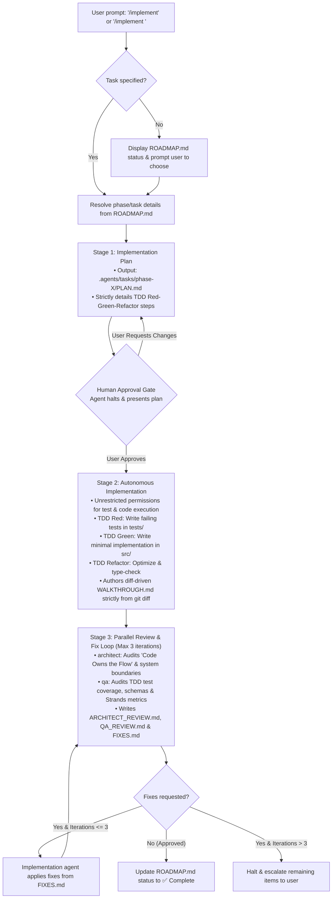

# Automated Task Implementation Workflow (`implement_task.md`)
## HSE Easy — Approach 1 (Code-Orchestrated Pipeline)

This document details the standardized 3-stage automated implementation workflow for roadmap milestones and tasks within the **HSE Easy Code-Orchestration** project.

---

## Core Rules

Before initiating this workflow, you MUST:
1. Always read [AGENTS.md](file:///c:/Users/Saksham/Git/poc/AIAgents/code-orchestration/AGENTS.md) to adhere strictly to the 7 mandatory rules (especially **Rule 1: "Code Owns the Flow"**, **Rule 2: Pydantic v2 Schemas**, and **Rule 7: Strict TDD**).
2. Ensure automation hooks are active by verifying [`.agents/hooks/auto_allow.py`](file:///c:/Users/Saksham/Git/poc/AIAgents/code-orchestration/.agents/hooks/auto_allow.py) and [`.agents/hooks.json`](file:///c:/Users/Saksham/Git/poc/AIAgents/code-orchestration/.agents/hooks.json) to bypass redundant approval prompts on safe build/test commands.

---

## Workflow Overview

---

## Stage Breakdown

### 0. Phase / Task Resolution
* **Trigger:** Invoked via `/implement`, `/implement <phase_or_task_id>` (e.g. `/implement 1`, `/implement Phase 2`, `/implement task 3`), or natural language prompt.
* **Action:**
  1. If no identifier is provided: Read [ROADMAP.md](file:///c:/Users/Saksham/Git/poc/AIAgents/code-orchestration/ROADMAP.md), display the milestone progress tracker table, identify the first `⏳ Pending` phase, and ask the user to confirm or choose an alternative.
  2. If an identifier is provided: Resolve the target phase from [ROADMAP.md](file:///c:/Users/Saksham/Git/poc/AIAgents/code-orchestration/ROADMAP.md), cross-referencing technical requirements in [.agents/docs/ARCHITECTURE.md](file:///c:/Users/Saksham/Git/poc/AIAgents/code-orchestration/.agents/docs/ARCHITECTURE.md) and [.agents/docs/SPECIFICATIONS.md](file:///c:/Users/Saksham/Git/poc/AIAgents/code-orchestration/.agents/docs/SPECIFICATIONS.md).
  3. Establish target artifact directory: `.agents/tasks/phase-<phase_id>/` (or `task-<task_id>/`).

---

### 1. Stage 1: Implementation Plan
* **Objective:** Formulate a deterministic, test-driven technical blueprint.
* **Action:**
  1. Retrieve task specifications from [ROADMAP.md](file:///c:/Users/Saksham/Git/poc/AIAgents/code-orchestration/ROADMAP.md), [ARCHITECTURE.md](file:///c:/Users/Saksham/Git/poc/AIAgents/code-orchestration/.agents/docs/ARCHITECTURE.md), and [SPECIFICATIONS.md](file:///c:/Users/Saksham/Git/poc/AIAgents/code-orchestration/.agents/docs/SPECIFICATIONS.md).
  2. Formulate a structured plan containing the following **mandatory sections**:
     - `## 1. Context & Task Scope`: Objectives, deliverables, and dependencies.
     - `## 2. Prerequisites`: Prior phases, Python environment, and substrate MCP availability.
     - `## 3. Strict TDD Strategy (Rule 7)`:
       - **Red Phase:** Exact test file to create (`tests/test_unit/...` or `tests/test_integration/...`), specific test functions, assertions, and expected failure modes.
       - **Green Phase:** Exact source files in `src/`, class/function signatures, and minimal implementation details.
       - **Refactor Phase:** Type annotations, Pydantic `ConfigDict` configuration, linting, and optimization.
     - `## 4. Proposed Changes & Specifications`: Concrete file paths, schema models, and logic.
     - `## 5. Architectural & Quality Audit Checklist`: Validation against `architect-review` and `code-reviewer` quality gates.
     - `## 6. Questions & Decisions for Human Approval`: Any design choices requiring human input.
* **Deliverable:** Save plan as `.agents/tasks/phase-<phase_id>/PLAN.md`.
* **Human Approval Gate:** Halt execution and present the plan to the user for explicit approval. Do not write source code before approval.

---

### 2. Stage 2: Autonomous Implementation (Upon Human Approval)
* **Trigger:** Starts **only after explicit human approval** of the Stage 1 plan.
* **Permissions & Autonomy:** Full, unrestricted permissions to create files, execute terminal commands, run tests (`pytest`), synchronize dependencies (`uv sync`), and inspect git status without pausing for approval.
* **Action:**
  1. **Red Phase (TDD):** Author automated test cases in `tests/`. Run `pytest` to verify the tests fail for the expected reason.
  2. **Green Phase (TDD):** Implement the minimal production code in `src/` to make all tests pass.
  3. **Refactor Phase (TDD):** Clean up code, add strict type annotations, and ensure zero unhandled warnings.
  4. **Diff-driven Walkthrough:** Run `git diff` via terminal to inspect actual workspace modifications. Author `.agents/tasks/phase-<phase_id>/WALKTHROUGH.md` strictly reflecting the `git diff` output, explaining code structure, changes made, rationale, and verification results without embedding raw diff patches.
  5. Automatically proceed directly to Stage 3 (Parallel Review) without pausing.
* **Deliverable:** Save `.agents/tasks/phase-<phase_id>/WALKTHROUGH.md`.

---

### 3. Stage 3: Parallel Review & Iterative Fix Loop (Max 3 Iterations)
* **Execution:** Run architectural and quality verification using the review skills:
  - **Architectural Audit:** Audit against [.agents/skills/architect-review](file:///c:/Users/Saksham/Git/poc/AIAgents/code-orchestration/.agents/skills/architect-review) (verifying "Code Owns the Flow", worker boundaries, MCP stdio isolation, template decoupling). Write evaluation to `.agents/tasks/phase-<phase_id>/ARCHITECT_REVIEW.md`.
  - **Quality Assurance Audit:** Audit against [.agents/skills/code-reviewer](file:///c:/Users/Saksham/Git/poc/AIAgents/code-orchestration/.agents/skills/code-reviewer) (verifying strict TDD adherence, Pydantic v2 schemas, Strands metrics extraction, test coverage). Write evaluation to `.agents/tasks/phase-<phase_id>/QA_REVIEW.md`.
* **Consolidated Feedback & Iterative Fix Loop:**
  1. In each pass, reviewers write any actionable remediation items into `.agents/tasks/phase-<phase_id>/FIXES.md`.
  2. If fixes are requested:
     - The implementation agent ingests `FIXES.md`.
     - Implements all requested fixes in a unified pass.
     - Runs `pytest` to confirm all tests remain green.
     - Cleans up `FIXES.md` and triggers the next review iteration.
  3. **Loop Boundary:** Maximum of **3 review iterations**.
  4. Once fully approved:
     - Update [ROADMAP.md](file:///c:/Users/Saksham/Git/poc/AIAgents/code-orchestration/ROADMAP.md) milestone table to mark the phase `✅ Complete`.
     - Present completion summary to the user.

